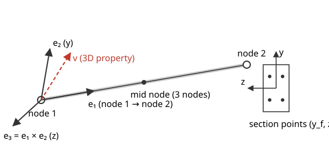

.. _beamelement:

Beam Element
============

Theory
------

Euler-Bernoulli beam (frame) elements, geometrically linear, in two (nodal dofs :math:`u_x, u_y, \theta_z`) or
three (:math:`u_x, u_y, u_z, \theta_x, \theta_y, \theta_z`) spatial dimensions, with 2 or 3 nodes (node order
end, end, mid as for ``Bar3``; the mid node lies at the middle of the straight beam). The node fields are
``displacement`` and ``rotation`` (ordered node by node).

==========  ===  =====  ==========================================  ===============================
Name        dim  nodes  interpolation (transverse / axial, twist)   integration along the axis
==========  ===  =====  ==========================================  ===============================
``B2D2``    2    2      cubic Hermite / linear                      3 Gauss points
``B2D3``    2    3      quintic Hermite / quadratic                 4 Gauss points
``B3D2``    3    2      cubic Hermite / linear                      3 Gauss points
``B3D3``    3    3      quintic Hermite / quadratic                 4 Gauss points
``B2D2CR``  2    2      co-rotational ``B2D2`` (finite rotations)   3 Gauss points
``B3D2CR``  3    2      co-rotational ``B3D2`` (finite rotations)   3 Gauss points
==========  ===  =====  ==========================================  ===============================

The names follow Marmot's scheme ``B<dimension>D<nodes>``, as ``T<dimension>D<nodes>`` of the trusses; the suffix
``CR`` marks the co-rotational variants. In Abaqus, ``B2D2`` and ``B3D2`` correspond to the cubic Euler-Bernoulli
beams ``B23`` and ``B33`` (``B<dimension><order>``); Abaqus has no 3-node Euler-Bernoulli beam (``B22``, ``B32``
are Timoshenko beams). Every node carries the displacement and the rotation; with the rotations as the slopes of
the transverse displacement (Hermite interpolation), 2 nodes give 4 values per transverse direction (cubic) and
3 nodes give 6 (quintic), at no additional degrees of freedom. In the local frame :math:`(\mathbf{e}_1, \mathbf{e}_2, \mathbf{e}_3)` (:math:`\mathbf{e}_1`
from node 1 to node 2, section coordinates :math:`y, z`), the transverse displacements :math:`v, w` are Hermite
polynomials of the nodal values and rotations :math:`\theta_z = v'`, :math:`\theta_y = -w'` (no shear deformation,
no shear locking).

The Hermite functions come from the conditions at the nodes: with the parameter :math:`s = x/L \in [0, 1]` (nodes at
:math:`s = 0, 1` and, for 3 nodes, :math:`1/2`), the monomials :math:`\mathbf{m}(s) = [1, s, s^2, \dots]` and the
matrix :math:`\mathbf{M}` of their values and slopes at the nodes, :math:`\mathbf{H}(s) = \mathbf{m}(s)^\mathsf{T}
\mathbf{M}^{-1}`. For 2 nodes these are the textbook cubic functions (e.g., Hughes, *The Finite Element Method*,
sec. 1.16), with :math:`v(s) = H_1 v_1 + H_2 \theta_1 + H_3 v_2 + H_4 \theta_2`:

.. math::

   H_1 = 1 - 3s^2 + 2s^3, \quad H_2 = L\,(s - 2s^2 + s^3), \quad H_3 = 3s^2 - 2s^3, \quad H_4 = L\,(-s^2 + s^3) .

The integration along the axis uses 3 Gauss points for 2 nodes (exact to degree 5) and 4 for 3 nodes (degree 7).
The curvature is linear (2 nodes) or cubic (3 nodes), so the elastic stiffness is a polynomial of degree 2 or 6, and
the consistent line load one of degree 3 or 5: both are integrated exactly. For 2 nodes, 2 points would suffice for
elastic beams; the third, at the middle, gives a plastic zone one more section to form in.

For a linear elastic material, the 2-node element reproduces the exact nodal values of a beam
loaded at its nodes, the 3-node element also the exact deflection under a uniform line load. The generalized
strains are

.. math::

   \varepsilon_0 = u', \qquad \kappa_y = \theta_y' = -w'', \qquad \kappa_z = \theta_z' = v'', \qquad
   \chi = \varphi' \qquad \text{(2D: } \varepsilon_0, \ \kappa = \kappa_z \text{)} .

**Section** (``BeamFiberSection``). The element knows no section shapes: the section is given by its integration
points :math:`(y_f, z_f, A_f)` (2D: :math:`(y_f, A_f)`), measured from the beam axis, so any shape can be used
(the framework generates the points, e.g., EdelweissFE's beam section: rectangles, circles, tubes, I-profiles,
polygons with holes, explicit point lists, with Gauss, Lobatto or Simpson rules). Every point has its own material
instance, created by name through the hypoelastic material factory, and its own state, so any hypoelastic material
of Marmot can be used. A point has the strains

.. math::

   \varepsilon_{11} = \varepsilon_0 + z_f \kappa_y - y_f \kappa_z, \qquad
   \gamma_{12} = - \alpha_T (z_f - z_c) \chi, \qquad \gamma_{13} = \alpha_T (y_f - y_c) \chi ,

and is evaluated in uniaxial stress (2D, ``computeUniaxialStress``) or in the beam stress state
:math:`\sigma_{22} = \sigma_{33} = \sigma_{23} = 0` (3D,
``Marmot::Materials::MaterialHypoElastic::computeBeamStress``: Newton iteration on the free strains with state
reset, condensed 3x3 tangent). The section forces :math:`(N, M_y, M_z, T)`
are the work conjugates of :math:`(\varepsilon_0, \kappa_y, \kappa_z, \chi)`. Unsymmetric sections and
non-principal axes (:math:`\int yz\,\mathrm{d}A \neq 0`) and sections off the axis couple naturally. Torsion is
Saint-Venant torsion about the centroid :math:`(y_c, z_c)` of the points without warping; the factor
:math:`\alpha_T = \sqrt{J / \sum_f ((y_f-y_c)^2 + (z_f-z_c)^2) A_f}` gives the torsional stiffness :math:`GJ` for the given
torsion constant :math:`J` (:math:`\alpha_T = 1` for circles and tubes); the shear center offset is neglected. The torque is
therefore exact for any section, but the fiber shear stresses :math:`\sigma_{12}, \sigma_{13}` are Saint-Venant
stresses only for circles and tubes: elsewhere they grow linearly with the distance from the centroid. For a square
of side :math:`a`, the fibers at the middle of a side carry :math:`0.46\,G a \chi` instead of the Saint-Venant
:math:`0.68\,G a \chi`, and the corners :math:`0.65\,G a \chi` instead of :math:`0`. For plastic torsion of
non-circular sections, the fiber shear stresses are an approximation.

Element properties:

   The local frame: :math:`\mathbf{e}_1` from node 1 to node 2, :math:`\mathbf{e}_2` the part of the orientation
   vector :math:`\mathbf{v}` normal to the axis (3D; in 2D :math:`\mathbf{e}_2` is :math:`\mathbf{e}_1` turned by
   +90 degrees), :math:`\mathbf{e}_3 = \mathbf{e}_1 \times \mathbf{e}_2`. The section (right) is seen from node 2,
   with :math:`\mathbf{e}_1` towards the viewer: the section coordinates :math:`y, z` are measured along
   :math:`\mathbf{e}_2, \mathbf{e}_3`.

* 2D: :math:`[n, y_1, A_1, \dots, y_n, A_n]`;
* 3D: :math:`[v_x, v_y, v_z, J, n, y_1, z_1, A_1, \dots, y_n, z_n, A_n]` with the orientation vector
  :math:`\mathbf{v}`, whose part normal to the axis is :math:`\mathbf{e}_2` (:math:`\mathbf{e}_3 = \mathbf{e}_1
  \times \mathbf{e}_2`).

A body force :math:`\mathbf{b}` (per volume) acts at the section points: it gives the consistent nodal forces and
moments of the line load :math:`\mathbf{q} = \mathbf{b} A` and, for a section whose centroid
:math:`\mathbf{r}_c = (0, y_c, z_c)` is off the axis, of the line moment :math:`\mathbf{m} = \mathbf{r}_c \times
\mathbf{q}` (e.g., the self-weight of an eccentric section, or an axial load on it).

Quadrature point states: ``normal force``, ``bending moment`` (2D) / ``bending moments`` and ``torque`` (3D),
``axial strain``, ``curvature`` (2D) / ``curvatures`` and ``twist rate`` (3D), ``section forces`` and
``section strains`` (all components), ``elastic energy``, ``dissipation``; the state of a section point :math:`k` as
``fiber k stress`` (:math:`\sigma_{11}, \sigma_{12}, \sigma_{13}`) or ``fiber k <material state>``.

Verification (``TestBeamElement``): cantilevers (tip force, moment, axial force, line load for 3 nodes, biaxial
bending, torsion) exact; an L-profile (non-principal axes) against the analytical solution with
:math:`I_y, I_z, I_{yz}`; rigid body motions; numerical tangents in von Mises plastic states; plastic moment
:math:`f_y \sum |y_f| A_f` and axial yield force; the limit load of von Mises cantilevers converges to
:math:`f_y Z / L` (rectangle, circle, T-section with its plastic neutral axis).

Limitations: geometrically linear (small rotations; a finite rigid rotation strains the element), no shear
deformation, one material per element (a composite section = several elements on the same nodes), no distributed
surface loads, no inertia. As any displacement-based fiber beam, a plastic hinge forms at the quadrature point
nearest to the peak moment: the limit load converges linearly with the element size. A section whose centroid is
off the axis couples the axial strain and the curvature (:math:`\varepsilon_0 = -y_c \kappa` in pure bending): the
3-node beams represent the linear axial strain of a cantilever under a tip load exactly, the 2-node beams (axial strain
constant per element) converge with :math:`h^2`.

How to use
----------

The element uses no units of its own: give coordinates, section coordinates and areas, material parameters and loads
in one consistent system, e.g., N, mm, MPa (then forces are in N, moments in N mm). A 2D cantilever ``B2D2`` of
length :math:`L` with a rectangle :math:`b \times h`:

* properties :math:`[n, y_1, A_1, \dots]`: :math:`n` points over the height, e.g., Gauss points of the height
  :math:`h` with areas :math:`b\,h\,w_i/2`, so that :math:`\sum A_f = bh` and :math:`\sum y_f^2 A_f = bh^3/12`;
* clamp the root: Dirichlet conditions on both node fields, ``displacement`` and ``rotation``;
* a tip force :math:`P` gives the tip deflection :math:`P L^3 / (3 E I)` with one element (exact, see the
  verification below); the ``bending moment`` at the quadrature points is :math:`P (L - x)`;
* fiber results: ``fiber 0 stress`` is :math:`(\sigma_{11}, \sigma_{12}, \sigma_{13})` of section point 0.

In EdelweissFE the section points are generated by the ``beam`` section (rectangles, circles, tubes, I-profiles,
polygons, explicit lists; see the EdelweissFE documentation of the sections), which also writes these properties.

Co-rotational variants
----------------------

``B2D2CR`` and ``B3D2CR`` take the properties, the section and the quadrature point states of ``B2D2`` /
``B3D2`` and allow arbitrary rigid rotations and large displacements with small local strains. The rigid motion is
split off by a co-rotated frame along the current chord (2D: Crisfield; 3D: Battini and Pacoste, with the mean of
the nodal second axes); in that frame the geometrically linear kinematics of ``B2D2`` / ``B3D2`` give the section
strains, fed incrementally to ``BeamFiberSection``. The tangent is consistent (material + geometric stiffness; in 3D
the Jacobian of the local map and the geometric stiffness are exact by forward automatic differentiation). In 3D the
nodal rotation dofs are total rotation vectors (additive parametrization, :math:`|\boldsymbol{\Psi}| < 2\pi`).
Therefore a nodal moment load on the ``rotation`` field of ``B3D2CR`` is a physical moment only for small rotations:
it acts on the rotation-vector dofs, i.e., it is work conjugate to :math:`\delta\boldsymbol{\Psi}`, not to the
spatial spin. Apply finite-rotation moments as force couples. (In 2D the rotation is additive, and nodal moments are
physical moments.)
Body forces are lumped to the nodes (:math:`\mathbf{b} A L / 2` each, on the axis: the moment of an eccentric section is
neglected). Axial strain measure: engineering strain of the chord.

Verification (``TestCorotationalBeamElement``, ``TestCorotationalBeamElement3D``): zero forces under rigid
rotations (also several turns in 2D), objectivity of nodal and section forces, numerical tangents (elastic and von
Mises plastic, large rotations), the tangent at the reference state equals the linear element, roll-up of a
cantilever into a full circle by an end moment, elastica under a tip force against the elliptic-integral solution,
the 45 degree bend (Bathe and Bolourchi) in 3D, plastic bending under large rigid rotations.

Implementation
--------------

.. doxygenclass:: Marmot::Discretizations::Elements::BeamElement
   :project: Marmot
   :members:

.. doxygenclass:: Marmot::Discretizations::Elements::BeamFiberSection
   :project: Marmot
   :members:

.. doxygenclass:: Marmot::Discretizations::Elements::CorotationalBeamElement2D
   :project: Marmot
   :members:

.. doxygenclass:: Marmot::Discretizations::Elements::CorotationalBeamElement3D
   :project: Marmot
   :members:
