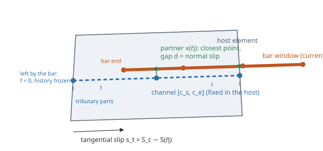

.. _embeddedbondelement:

Embedded Bond Element
=====================

Theory
------

Couples an embedded reinforcement bar (a truss or beam element; only its displacements are coupled) to the host
continuum element it lies in by bond-slip. The nodes of the element are the nodes of the bar element, followed by
the nodes of the host element (``Tri3``, ``Quad4``, ``Quad8``, ``Tetra4``, ``Hexa8``, ``Hexa20``: the shapes of the
continuum elements in Marmot). The
slip is the displacement of the bar relative to the host material point it lies at, in the local frame
:math:`\mathbf{R} = [\mathbf{t}, \mathbf{n}_1, \mathbf{n}_2]` of the bar axis,

.. math::

   \mathbf{s} = \mathbf{R}^\mathsf{T} \Big( \sum_i M_i(\eta)\, \mathbf{u}_i
     - \sum_a N_a(\boldsymbol{\xi}(\eta))\, \mathbf{u}_a \Big),

with the host parent coordinates :math:`\boldsymbol{\xi}(\eta)` found by the inverse isoparametric mapping of the host
geometry (``GeometryElement::parentCoordinates``) at initialization. The tangent :math:`\mathbf{t}` points from the
first to the last bar node; in 2D, :math:`\mathbf{n}_1` is :math:`\mathbf{t}` rotated by +90°; in 3D, the normals
are an arbitrary right-handed pair that may differ between integration points, so the normal components of slip and
bond stress are not comparable between points (the bond-slip laws are isotropic in the normal plane). A
:ref:`bond-slip law <bondsliplaws>` gives the bond stress :math:`\boldsymbol{\tau}(\mathbf{s})`, integrated over
the bar perimeter :math:`p` and the part :math:`[\eta_s, \eta_e]` of the bar element inside the host element with a
Gauss-Lobatto rule of the quadrature catalogue (``gaussLobattoExactToDegree``), whose end points sit at the ends of
the bar part. The formulation is geometrically linear (reference frame).

Names: ``EB<nDim>D<nBarNodes><host>``, e.g., ``EB2D2T3``, ``EB2D2Q4``, ``EB2D3Q8``, ``EB3D2H8``, ``EB3D3H20``,
``EB3D2T4``.

Element properties: ``[perimeter, eta_s, eta_e, (number of integration points 2..5)]`` with :math:`p > 0` and
:math:`-1 \le \eta_s < \eta_e \le 1`. They must be assigned before the bond-slip law (the number of integration
points sets the number of law instances).

Implementation
--------------

.. doxygenclass:: Marmot::Discretizations::Elements::EmbeddedBondElement
   :project: Marmot
   :members:

Large slip
----------

``EmbeddedLargeSlipBondElement`` lets the bar slide out of (or into) its host element.

Glossary:

- *bar*: the 1D elements of one unbranched bar; :math:`\eta \in [-1, 1]` is the parameter of a bar element,
  :math:`S` the reference arc length along the bar;
- *window*: the consecutive bar elements a bond element may couple to, with the window parameter
  :math:`c = k + (\eta + 1)/2 \in [0, n_\mathrm{bar\,elements}]` in bar element :math:`k`;
- *channel*: the part :math:`[c_s, c_e]` of the original bar path inside the host element, fixed in the host; the bond
  history belongs to its points, i.e., to the concrete;
- *channel point*: a Gauss-Lobatto point of the channel; its *tributary part* :math:`[S_a, S_b]` is the part of the
  channel its weight represents;
- *partner*: the point of the current bar next to a channel point;
- *covered fraction* :math:`x` of a tributary part, and the *fade* :math:`f(x) = 3x^2 - 2x^3`.

It is a point-to-segment contact formulation (Wriggers, *Computational Contact Mechanics*, 2006, ch. 4; Laursen,
*Computational Contact and Impact Mechanics*, 2002):

.. list-table::
   :header-rows: 1

   * - bond element
     - contact mechanics
   * - channel point
     - slave point
   * - bar window
     - master segments
   * - partner :math:`\bar\eta`
     - closest point projection
   * - normal slip
     - normal gap
   * - tangential slip :math:`s_t`
     - tangential slip in the convected coordinate of the master

**Kinematics.** The partner of a channel point at :math:`\mathbf{x}_c` (moving with the host) solves

.. math::

   g(\bar\eta) = \big(\mathbf{x}(\bar\eta) - \mathbf{x}_c\big) \cdot \mathbf{x}_{,\eta}(\bar\eta) = 0

on the current bar, extended linearly beyond the window ends; it is searched from the bar element of the previous
partner. With the gap :math:`\mathbf{d} = \mathbf{x}(\bar\eta) - \mathbf{x}_c` and the current frame
:math:`[\mathbf{t}, \mathbf{n}_1, \mathbf{n}_2]` at the partner (:math:`\mathbf{t}` along the current bar, the normals
carried from the reference frame by the smallest rotation), the slip is

.. math::

   s_t = S_c - S(\bar\eta), \qquad s_{n,i} = \mathbf{n}_i \cdot \mathbf{d}:

the reference arc length the bar has slid past the channel point, and the normal gap. :math:`s_t` and
:math:`|\mathbf{s}_n|` are invariant under rigid motions of host and bar; in 2D the element is objective. In 3D the
normals follow the bending of the bar but not a rotation about its axis, so under a rigid rotation about an axis not
normal to the bar the normal slip components spin about the axis: laws whose normal response depends only on
:math:`|\mathbf{s}_n|` (linear normal stiffness, Coulomb friction) stay objective, a stored normal history (the
plastic normal slip of the MC2010 crushing cap) does not.

**Bond and fade.** The bar ends move by :math:`s_t`, so the covered fraction of a tributary part is

.. math::

   x = \frac{\min(S_b, S_\mathrm{end} + s_t) - \max(S_a, S_\mathrm{start} + s_t)}{S_b - S_a} \in [0, 1].

The bond of the point is scaled by :math:`f(x)` (:math:`C^1`: a kink would make Newton's method cycle). A channel point
the bar has left (:math:`f = 0`) has no bond; its slip, bond stress and law history are kept until the bar returns.
The bonded length shrinks with the pull-out, up to the smoothing of :math:`f` over the tributary part at the bar end:
a bar slid by 1 into a channel of length 3 with 3 points is bonded over :math:`0.5 f(1) + 2 f(0.75) = 2.1875`
instead of 2. For small displacements and a covered channel, the element agrees with the small-slip element to first
order (tested entry by entry for forces and tangent).

**Residual and tangent.** With :math:`p\,\Delta S` the perimeter times the tributary length and
:math:`\mathbf{B} = \partial\mathbf{s}/\partial\mathbf{u}` over the host dofs and the dofs of the partner's bar
element,

.. math::

   \mathbf{f} = \sum f\, p\,\Delta S\, \mathbf{B}^T \boldsymbol{\tau}, \qquad
   \delta\bar\eta = -\frac{(\delta\mathbf{x}_b - \delta\mathbf{x}_c)\cdot\mathbf{x}_{,\eta} + \mathbf{d}\cdot
   \delta\mathbf{x}_{,\eta}}{\mathbf{x}_{,\eta}\cdot\mathbf{x}_{,\eta} + \mathbf{d}\cdot\mathbf{x}_{,\eta\eta}},
   \qquad \delta s_t = -S_{,\eta}\,\delta\bar\eta, \qquad
   \delta s_{n,i} = \mathbf{n}_i\cdot\delta\mathbf{d} + \mathbf{d}\cdot\delta\mathbf{n}_i .

The tangent :math:`\mathbf{K} = p\,\Delta S \big( f\,\mathbf{B}^T \frac{\partial\boldsymbol{\tau}}{\partial
\mathbf{s}}\mathbf{B} + f'\, \frac{\mathrm{d}x}{\mathrm{d}s_t} \mathbf{B}^T\boldsymbol{\tau} \otimes \mathbf{B}_t +
f\, \partial(\mathbf{B}^T\boldsymbol{\tau})/\partial\mathbf{u}|_{\boldsymbol{\tau}} \big)` takes the material part
from the algorithmic tangent of the bond-slip law and the fade part analytically; the geometric part (the second
derivatives of the projection and the frame, times the bond stress) is the central difference of the analytic
:math:`\mathbf{B}` over the host and partner dofs only, without evaluating the law. The tests check the whole
tangent against central differences of the forces.

**Bars and limitations.** The bar should be straight or smoothly curved: at a kink, a point on the convex side has the
kink node as its partner, its tangential slip stays constant while it is in that wedge (width about :math:`g\alpha`),
and the slip jumps by about :math:`2 g \tan(\alpha/2)` (gap :math:`g`, kink angle :math:`\alpha`) as the point
crosses the kink. Rotations of the bar axis near 180 degrees against the reference are not supported. For curved
quadratic bars the arc length is integrated numerically, and the tangent is consistent only up to that quadrature
error.

Nodes: the host element nodes, followed by the unique nodes of the window in bar order (bar2: ``e0, e1, ..., eN``;
bar3: ``e0, m0, e1, m1, ..., eN``). Unlike the small-slip element, the host comes first, so that the element is drawn
as its host element (the leading nodes), on which the channel lies.

Names: ``EBLS<nDim>D<nBarNodes><host>W<nBarElements>``, with 1 to 48 bar elements in the window, e.g.,
``EBLS2D2Q4W3``, ``EBLS3D3H20W12``. The window is a runtime size of one class per bar and host shape; one name per
window size is registered because the element factory takes a function of the element label only. A larger window is
an unknown element for the factory.

Element properties: ``[perimeter, c_s, c_e, start is a bar end, end is a bar end, (number of channel points 2..5)]``
with :math:`0 \le c_s < c_e \le n_\mathrm{bar\,elements}` within one bar element and the flags 0 or 1. If a partner
lies beyond an end of the window that is not an end of the bar, the window is too small for the slip and an exception
is thrown (EdelweissFE then cuts the increment back, and stops at the minimum increment).

States per channel point: ``slip``, ``bond stress``, ``elastic energy density`` and ``dissipation density`` (of the
law, not faded), ``dissipation`` (the faded dissipated energy), ``partner`` (window parameter), ``active`` (1 while
the bar covers the point) and ``covered fraction`` (:math:`x`).

.. doxygenclass:: Marmot::Discretizations::Elements::EmbeddedLargeSlipBondElement
   :project: Marmot
   :members:
